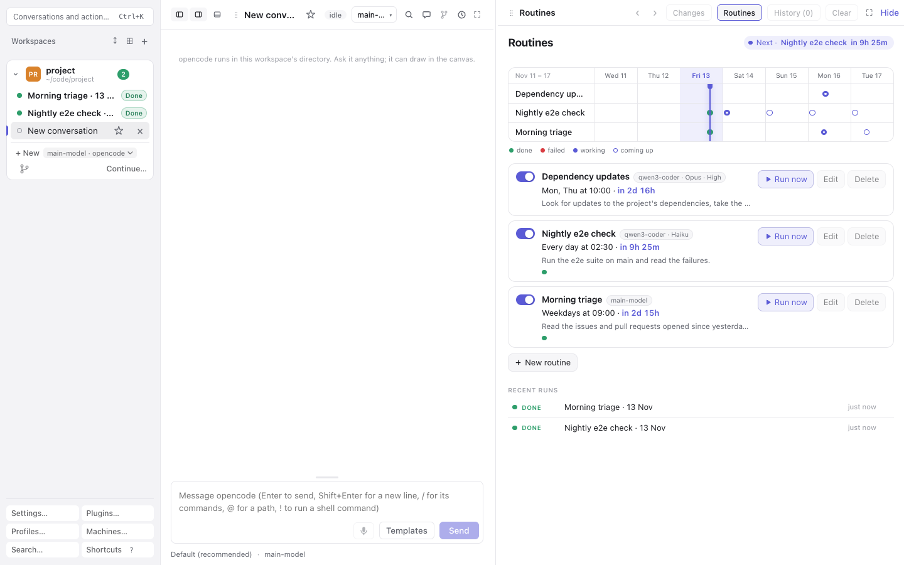
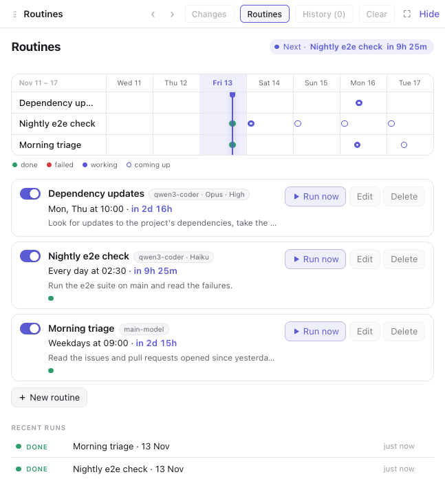
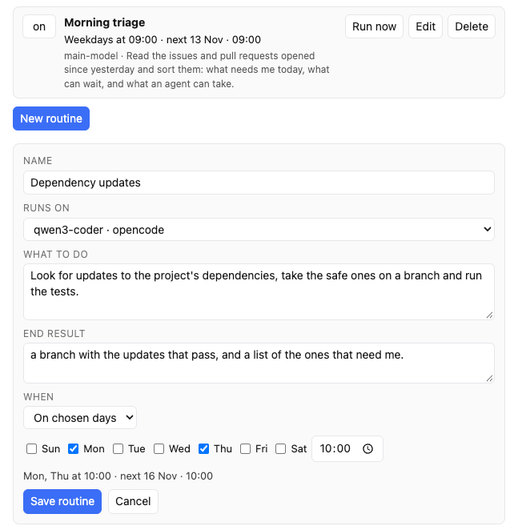

# Routines

A [Mirador](https://github.com/sodre90/mirador) plugin that runs a prompt in a workspace on a schedule you set.

Each routine is a name, a profile, what the agent should do, what you want to be able to see when it ends, and when it
runs: weekdays, every day, chosen days at a time, every few hours, or a cron line. It runs on the profile's model and
effort, or on ones of its own, chosen from those the profile's agent offers. When one is due, Mirador starts a fresh
conversation for it in the workspace, which works on the message and then waits for you like any other: a *Done* mark
in the sidebar, a notification, a place in the phone app. Slots missed while the Mac slept come back as one run, so a
weekday routine set for 09:00 runs once on Monday morning, not five times. A routine switched back on, or given a new
schedule, starts from then: the slots that passed meanwhile don't run.

The workspace's **Routines** tab opens on the week: a row for each routine, with the runs of the last two days as dots
coloured by how they ended and the coming runs as rings, against a line that marks now. Below it are the routines, each
counting down to its next run with its last runs beside it, ready to switch off, edit or start now, and the recent
runs. **Skip next** steps over a routine's coming run, say after you started one by hand: the countdown moves on to the
run after, and **Don't skip** puts it back. Click a run, in the list or in the week, to open the conversation it
started. An empty tab offers a few routines to start from.

## Develop

    bun install
    bun run test          # the schedule and the plugin's work
    bun run typecheck

`e2e/routines-plugin.spec.ts` drives the tab in a real Mirador; it needs Mirador's own e2e helpers, so it runs from a
Mirador checkout, as its header says. `e2e/screenshots.spec.ts` runs the same way and retakes the pictures in
`screenshots/`.

Try it in your own Mirador:

    ln -s "$PWD" ~/.mirador/plugins/routines

Mirador loads it from its next start (`⌘⇧R` in a conversation on this computer).
